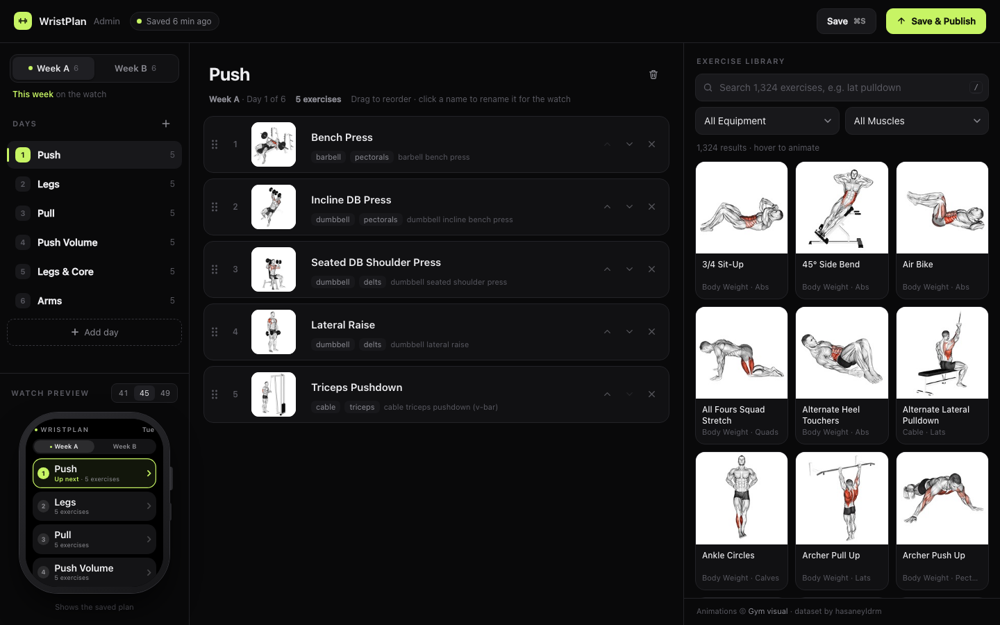

# WristPlan

**My trainer's workout plan on my Apple Watch: just the exercise name and a looping animation of how to do it.**
It's free, has no app to install, and does no tracking.


---

## The problem

My trainer gives me a plan: a few days a week, five or six exercises each, and two different weeks that alternate. At the gym, all I need at any moment is the answer to *"what's next, and how does it go?"*

What I tried before didn't fit:

- **Fitness apps** are built around tracking: sets, reps, timers, rest, streaks, logins. I don't want to log anything; I want to glance at my wrist and see the next movement.
- **My phone** works, but it means unlocking and scrolling between sets, then getting distracted.
- **A native watchOS app** needs the paid Apple Developer Program ($99/year) to stay installed. With a free Apple ID, a sideloaded app expires every 7 days.
- **Expo / React Native** can't build watch UI, and EAS iOS device builds need the paid account too.

So I needed something that:

1. runs on the watch, **for free, permanently**;
2. shows **only** the exercise name and a demonstration;
3. is **easy to update** when the trainer changes the plan;
4. still works if the gym's signal is bad.

## My solution

A **static web page** built for a watch-sized screen, hosted free on **Vercel** and opened in a free watch browser, plus a **local admin portal** on my laptop for building the plan.

```
 laptop                                   GitHub → Vercel                 Apple Watch
┌──────────────────────────┐   Publish   ┌──────────────────┐   HTTPS   ┌──────────────────────┐
│ Admin portal (Node, 0 dep)│ ──git push─▶│ site/  (static)  │ ────────▶ │ watch browser         │
│ search 1,324 exercises    │             │  index.html      │           │ (Ant / Fern / …),     │
│ build Week A / Week B     │             │  plan.json       │           │ bookmarked            │
│ rename for the watch      │             │  anim/<id>.png   │           │ cached for offline    │
└──────────────────────────┘             └──────────────────┘           └──────────────────────┘
```

- **No App Store, no developer account, no expiry.** It's just a bookmarked web page.
- **One-tap updates.** I edit the plan in the admin and click *Save & Publish*. That commits and pushes `site/`, and Vercel redeploys in about 30 seconds.
- **Alternating weeks.** Week A and Week B rotate every Monday. The watch works out which week it is, and I can still peek at the other one.
- **Works offline.** The watch keeps the last plan it loaded and preloads the day's animations when I open it.

## Preview

### On the watch

| | |
|---|---|
| **Home** | Week A / Week B tabs, with a dot for the current week. The day after the one I did last is highlighted as **Up next**. |
| **Exercise** | Looping animation, the name, and *Day · n of N*. A progress bar sits at the top. |
| **Controls** | Tap the right ⅔ of the screen for next, the left ⅓ for previous, or swipe. The ‹ button goes back to the days. |
| **Done** | A check animation, then what's next: the next day, or the first day of next week. |

### Admin portal (laptop)



- **Left:** Week A / B tabs (double-click to rename; *Make this week* resets the rotation), the days (drag to reorder), and a **live watch preview** at 41, 45 or 49 mm.
- **Middle:** the selected day's exercises. Rename each one to whatever my trainer calls it, drag or ↑↓ to reorder, ✕ to remove.
- **Right:** a searchable library of 1,324 exercises with equipment and muscle filters. Hover to animate, click to add. Press `/` to jump to search.

## Getting started

Needs **Node 18+** and **git**.

### 1. Run the admin

```bash
npm run setup     # one-time: downloads the exercise library (~300 MB, not deployed)
npm run admin     # → http://localhost:4321
```

When the trainer sends a plan, search each exercise, click the right animation, and rename it to match their wording. Press **Save** (⌘S) to write `site/plan.json` and generate the animations.

### 2. Deploy (one-time)

Push the repo to GitHub, then on vercel.com use **Add New → Project** and import it. `vercel.json` already sets everything up, so there's no build step.

From then on, **Save & Publish** in the admin runs `git add site && git commit && git push`, and Vercel redeploys.

### 3. Put it on the watch

1. On the iPhone, open the Watch app → App Store and install a free watch browser (e.g. **Ant Browser**, **Fern Browser** or **Searchino**).
2. Open the Vercel URL in it and bookmark it. Alternatively, iMessage the link to yourself and tap it on the watch.

## How it works

| Decision | Why |
|---|---|
| **A web page, not a watch app** | It's the only way to stay free and permanently installed. |
| **Zero dependencies, no build step** | Both pages are single HTML files and the admin server is plain Node, so there's nothing to update or break. |
| **Old-WebKit-safe watch page** | Watch browsers run limited WebKit, so the page uses ES5, XHR instead of `fetch`, no flex `gap` and no `aspect-ratio`. Sizes are in `vw` for 176–205 px screens. |
| **Sprite sheets instead of GIFs** | Some watch browsers only show a GIF's first frame. On Save, each GIF is decoded and turned into one tall PNG of all its frames, and the page steps through them with JS timers using the original frame timings. |
| **Black backdrop** | The source animations have white backgrounds. Save flood-fills the white backdrop to black from the frame edges, so the figure sits straight on the OLED screen while the machines' white frames stay white. |
| **Alternating weeks** | `plan.json` stores the weeks plus `weekAnchor`, the Monday Week A starts. Current week = weeks since the anchor, mod 2, so it never resets at month boundaries. |

```
admin/server.mjs   local server: library API, plan validation, animation build, git publish
admin/index.html   admin UI
admin/gif.mjs      zero-dep GIF decoder, backdrop darkening, sprite-sheet PNG writer
site/index.html    the watch page (what Vercel serves)
site/plan.json     the plan, written only by the admin
site/anim/         one sprite sheet per exercise in the plan (generated)
scripts/setup.mjs  downloads the exercise dataset into ./dataset (gitignored)
```

## Credits and licence

- Exercise animations © **[Gym visual](https://gymvisual.com/)**, from the [exercises-dataset](https://github.com/hasaneyldrm/exercises-dataset) by hasaneyldrm.
- They're redistributed with permission at their original 180×180 size, with attribution required. The watch page keeps the credit line.
- WristPlan only recolours the white backdrop for the dark UI.
- This deployment is for **personal use**. Check Gym visual's terms before making anything like it public or commercial.
