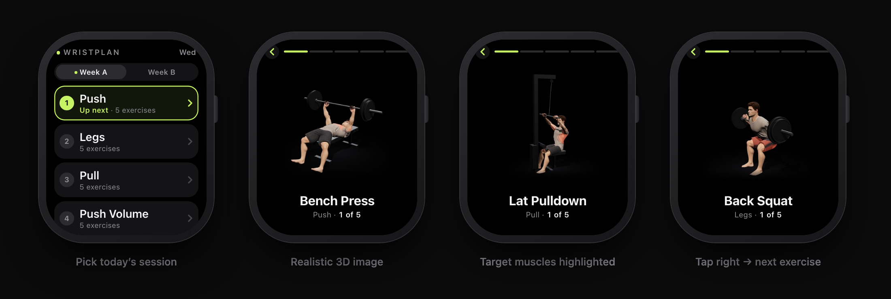

# WristPlan

A minimal workout viewer for Apple Watch. It shows one thing per screen: the name of the next exercise and a sharp, realistic 3D image of it being performed, with the target muscles highlighted.

WristPlan runs as a static web page opened in a watch browser, so it needs no App Store listing and no paid Apple Developer account. Plans are built on a laptop in a local admin portal and published with one click.



## Contents

- [Features](#features)
- [Why a web page](#why-a-web-page)
- [How it works](#how-it-works)
- [Getting started](#getting-started)
- [Using the admin portal](#using-the-admin-portal)
- [Exercise images](#exercise-images)
- [Project structure](#project-structure)
- [Development](#development)
- [Limitations](#limitations)
- [Credits and licensing](#credits-and-licensing)

## Features

**On the watch**

- **Realistic 3D images.** A lifelike character is shown at the peak of each exercise with real equipment: barbells, dumbbells, benches, cable stations and machines. The target muscles are highlighted in red.
- **Built for a glance.** Each screen shows only the exercise name, the image and the position in the session (for example, *Push · 2 of 5*).
- **Alternating weeks.** Plans can hold two weeks (A and B) that alternate every Monday. The watch opens the current week and highlights the next day to train.
- **Simple controls.** Tap the right side of the screen for the next exercise or the left side for the previous one, or swipe.
- **Fast and light.** Each image is about 11 KB, and the next exercise's image is loaded ahead of time. The last plan is cached in case the connection drops.
- **No tracking.** There are no sets, reps, timers, accounts or logs.

**On the laptop**

- **Exercise library.** Search 1,324 exercises and filter them by equipment and muscle.
- **Plan builder.** Build days for each week, rename exercises to match the trainer's wording, and reorder them by dragging.
- **Live watch preview.** See the result at 41, 45 or 49 mm sizes before publishing.
- **One-click publish.** *Save & Publish* renders any new images, commits the site and pushes it, and Vercel redeploys automatically.


## Why a web page

A native watchOS app needs the paid Apple Developer Program (US$99 a year) to stay installed. Apps sideloaded with a free Apple ID expire every seven days. Cross-platform tools such as Expo and React Native cannot build watch interfaces, and EAS device builds also require the paid account.

A static page served from Vercel and bookmarked in a free watch browser avoids all of these costs, and it never expires.

## How it works

```
 Laptop                                     GitHub → Vercel                Apple Watch
┌───────────────────────────┐   Publish   ┌───────────────────┐   HTTPS   ┌───────────────────────┐
│ Admin portal (Node)        │ ─git push──▶│ site/ (static)    │ ────────▶ │ Watch browser         │
│ • exercise library         │             │ • index.html      │           │ (Ant, Fern, Searchino) │
│ • plan builder             │             │ • plan.json       │           │ • bookmarked page     │
│ • 3D renderer              │             │ • anim/<id>/*.jpg │           │ • cached for offline  │
└───────────────────────────┘             └───────────────────┘           └───────────────────────┘
```

1. The **admin portal** runs locally. It edits the plan and, on Save, writes `site/plan.json` and renders one image per exercise into `site/anim/`.
2. **Publishing** commits and pushes the `site/` folder. Vercel serves it as-is, with no build step.
3. The **watch page** loads `plan.json` and shows each exercise's image.

## Getting started

### Requirements

- **Node.js 18 or later**
- **git**
- **Brave or Google Chrome**, used headless to render the 3D images
- An internet connection while rendering (the renderer loads three.js from a CDN)

### Installation

```bash
git clone <your-fork-url> wristplan
cd wristplan
npm run setup     # one-time: downloads the exercise library (~300 MB) and the 3D character (~11 MB)
npm run admin     # starts the admin portal at http://localhost:4321
```

Neither download is committed to the repository or deployed.

### Deploying

1. Push the repository to GitHub.
2. In Vercel, choose **Add New → Project** and import the repository. `vercel.json` already configures the output folder and caching, so no build settings are needed.
3. From then on, **Save & Publish** in the admin portal deploys every change.

### Setting up the watch

1. On the iPhone, open the **Watch** app, go to the App Store, and install a free watch browser such as **Ant Browser**, **Fern Browser** or **Searchino**.
2. Open the Vercel URL in that browser and bookmark it. Alternatively, send the link to yourself in Messages and tap it on the watch.

## Using the admin portal

1. **Choose a week.** Use the Week A / Week B tabs at the top left. Double-click a tab to rename it. *Make this week* sets which week the watch treats as current.
2. **Add days.** Click **+ Add day**, then name the day (for example, *Push*).
3. **Add exercises.** Search the library on the right and click an exercise to add it to the selected day. Hover over a card to preview the original illustration.
4. **Adjust the list.** Rename an exercise to match the trainer's wording, reorder by dragging or with the arrows, and remove with ✕.
5. **Choose the image (optional).** Each exercise is matched to a 3D movement automatically. Use the menu on the exercise row to pick a different movement, or *Original illustration* to use the dataset's version.
6. **Save** (⌘S) to write the plan and render new images, or **Save & Publish** to deploy as well.

Rendering takes well under a second per new exercise. Previously rendered exercises are reused, so later saves are usually instant.

## Exercise images

Each exercise is shown as a single still image. Earlier versions played animations, but watch browsers proved too limited: some show only the first frame of a GIF, watchOS blurs large images, and frame-by-frame playback was too slow over the watch's connection. A single small, sharp image works reliably everywhere.

### 3D renders

The renderer in `tools/render3d/` is a three.js scene that runs in a headless browser.

- **Character:** a rigged, public-domain (CC0) human model.
- **Posing:** an inverse-kinematics rig that keeps hands on the equipment and feet planted. The fingers are curled procedurally into a grip, because the model has no finger bones.
- **Equipment:** built procedurally in 3D, including benches, barbells, dumbbells, cable stations and machines.
- **Pose:** each movement is defined as a full rep, and the image is taken at its peak, where the target muscles are most contracted.
- **Muscle highlights:** painted onto the mesh from the dataset's primary and secondary muscles.
- **Output:** a 360 × 360 JPEG of about 11 KB, twice the size of the watch tile, so it is always downscaled and stays sharp.

Images are cached by movement, muscles and renderer version, and only new or changed exercises are rendered. There are 31 movements, covering presses, raises, curls, extensions, rows, pulldowns, squats, lunges, hinges, leg machines and core work.

### Original illustrations (fallback)

Exercises without a 3D movement, mostly stretches and cardio, use the first frame of the dataset's original illustration, with its white background changed to black to match the watch interface.

## Project structure

```
admin/
  server.mjs         Local server: library API, plan validation, image sync, git publish
  index.html         Admin portal (single file)
  motion-map.mjs     Matches library exercises to 3D movements, muscles and equipment
  gif.mjs            GIF decoder used for the fallback illustrations
tools/render3d/
  render.html        three.js scene: character, rig, equipment, movements, muscle shader
  render.mjs         Headless-browser driver used by the admin server
site/                Deployed as-is by Vercel
  index.html         Watch page (single file, compatible with older WebKit)
  plan.json          The workout plan, written by the admin portal
  anim/<id>.jpg      One image per exercise in the plan (.png for original illustrations)
scripts/setup.mjs    Downloads the exercise dataset and the 3D model
docs/                Screenshots used in this README
```

The project has no runtime dependencies and no build step. Both pages are single HTML files, and the server uses only Node's standard library.

## Development

| Task | Command |
| --- | --- |
| Start the admin portal | `npm run admin` (set `PORT` to change from 4321) |
| Preview a movement as six stills | `npm run strip -- <movement> [outDir]` |

### Adding a movement

1. Define it in `EX` inside `tools/render3d/render.html`: the equipment setup, camera direction, rep timeline and pose function.
2. Review it with `npm run strip -- <movement>`.
3. Register the key, label and a name-matching rule in `admin/motion-map.mjs`.
4. Save the plan in the admin portal to render it.

To force every exercise to re-render after a renderer change, increase `RENDER_STYLE` in `tools/render3d/render.mjs`.

### Watch page compatibility

Watch browsers run limited versions of WebKit, so `site/index.html` avoids modern-only features. It uses ES5 syntax and `XMLHttpRequest` instead of `fetch`, and avoids flexbox `gap` and `aspect-ratio`. Sizes use viewport units so that layouts fit screens about 176 to 205 px wide.

## Limitations

- The movements are hand-choreographed with realistic timing; they are not motion capture.
- Hands form a closed grip, so the thumbs do not wrap around bars, and push-ups are shown on the knuckles.
- Exercises outside the 31 movements fall back to the dataset's lower-resolution original illustration.
- Rendering requires Brave or Chrome and an internet connection on the laptop.

## Credits and licensing

- **3D character:** "Man Base Mesh" by [Grab3D](https://grab3d.com/models/characters/man-base-character/), released under CC0 1.0 (public domain). The 3D movements, equipment and renders are original to this project.
- **Exercise data and original illustrations:** © [Gym visual](https://gymvisual.com/), via the [exercises-dataset](https://github.com/hasaneyldrm/exercises-dataset) by hasaneyldrm. These are redistributed with permission at their original 180 × 180 size, with attribution required; the watch page displays the credit. WristPlan changes only their background colour.
- **three.js:** MIT licence, loaded from a CDN at render time.

This deployment is intended for personal use. Review Gym visual's terms before using the original illustrations in a public or commercial product. The repository itself does not currently include an open-source licence.
